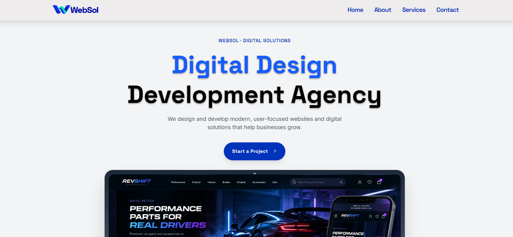

# WebSol — Digital Agency Landing Page

A modern, responsive landing page for a fictional digital agency, developed as part of the **AppRo8 Frontend Internship task**.

Built with a focus on responsive design, interactive components, smooth animations, and accessibility.



## Technologies Used

- React.js
- JavaScript (ES6+)
- Vite
- Tailwind CSS v4
- Motion for React
- Embla Carousel
- React Icons
- React Router
- Vercel

## Features

### Responsive Design & Navigation
- Mobile-first layout for desktop, tablet, and mobile
- Sticky navbar with smooth section navigation
- Animated mobile menu with keyboard and Escape key support
- Back to Top button with smooth scrolling

### Interactive Components
- Automatic hero slideshow with manual controls and press-to-pause
- Responsive services carousel with navigation controls
- Interactive contact form with client-side validation and error feedback

### Animations & Accessibility
- Scroll-triggered entrance animations and interactive hover effects
- Animated floating elements in the hero section
- Reduced-motion support
- Semantic HTML, accessible labels, and visible keyboard focus indicators

## Getting Started

```bash
git clone https://github.com/delaramfarzad9/landing-page-project.git
cd landing-page-project
npm install
npm run dev
```

## Live Demo

[View WebSol](https://landing-page-project-rose.vercel.app/)

## Note

This is a frontend demonstration project. The contact form validates user input but is not connected to a backend or email service.
